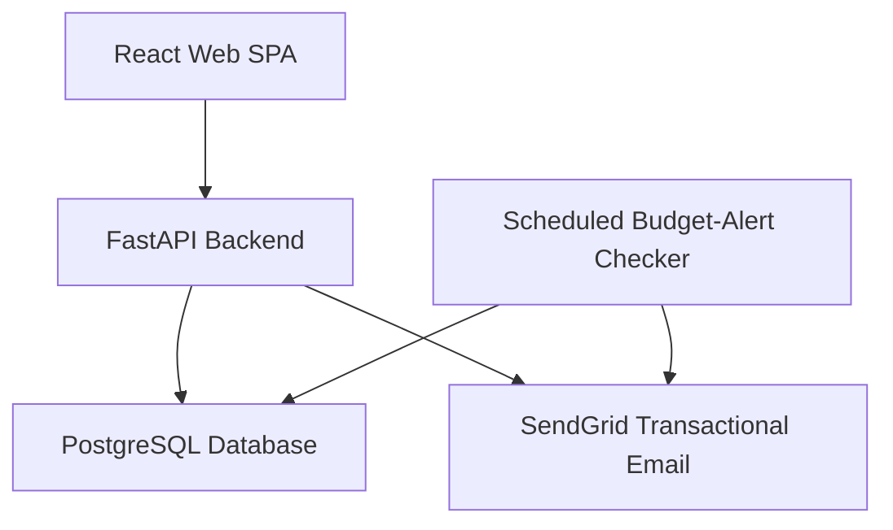
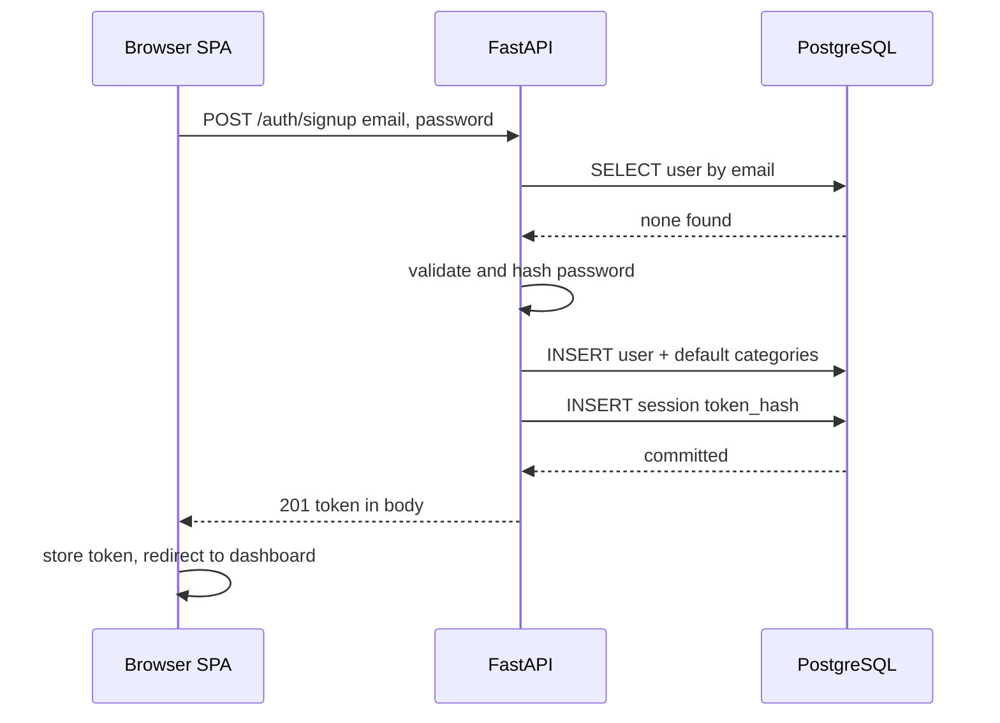
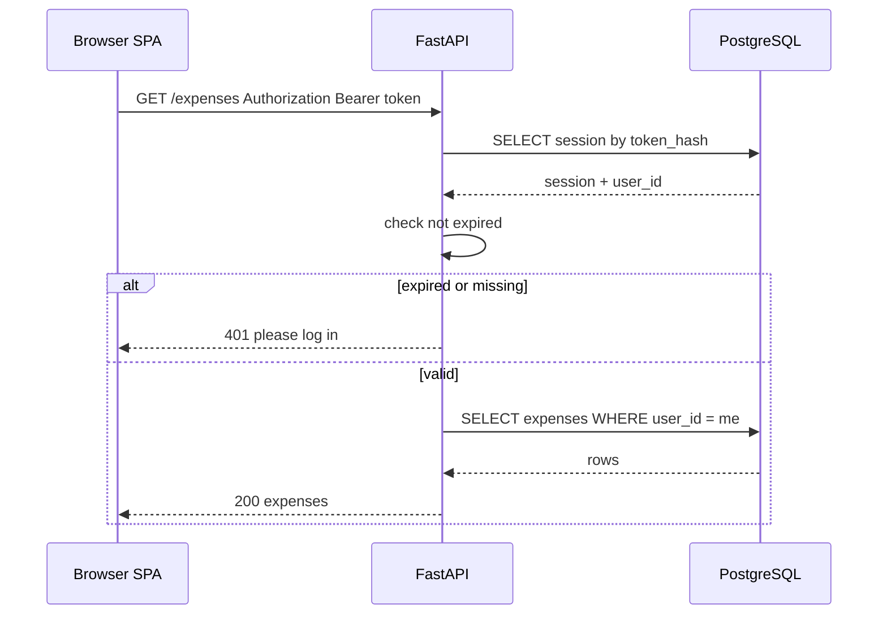
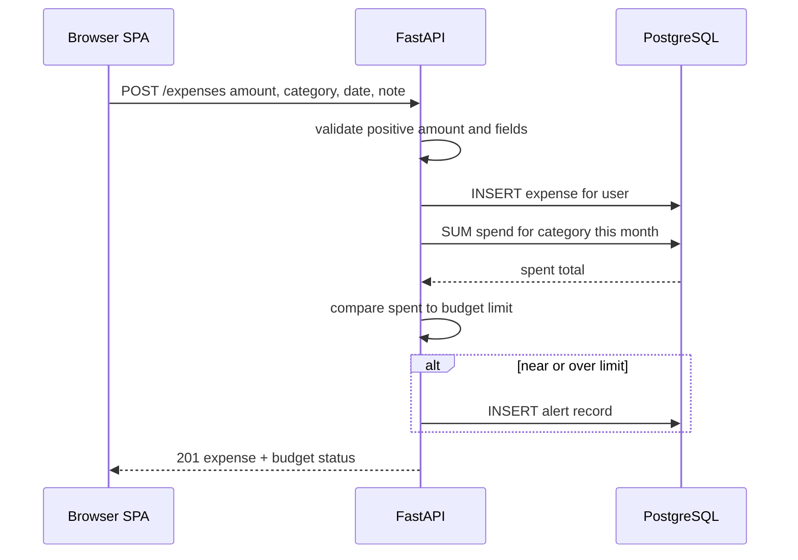
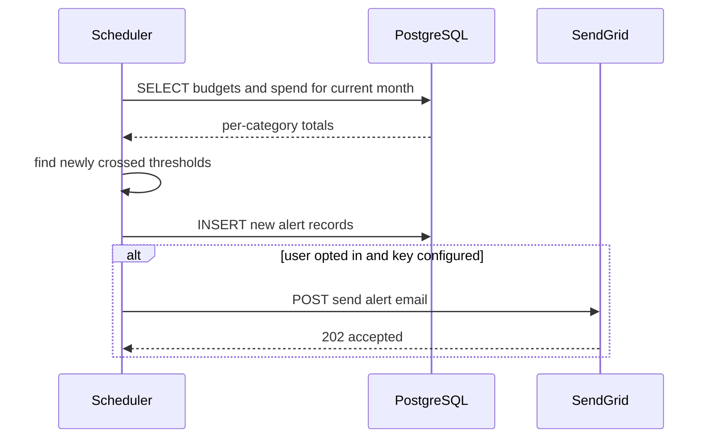
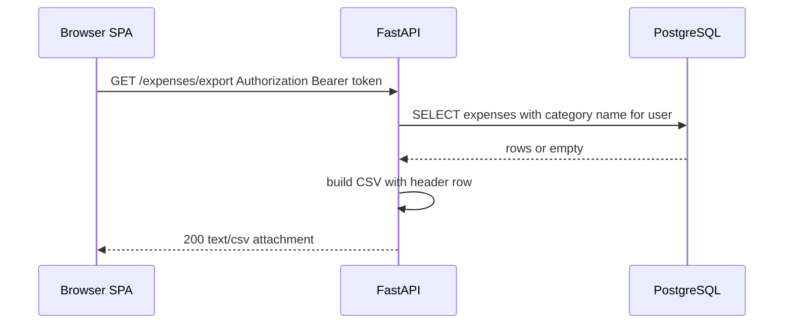
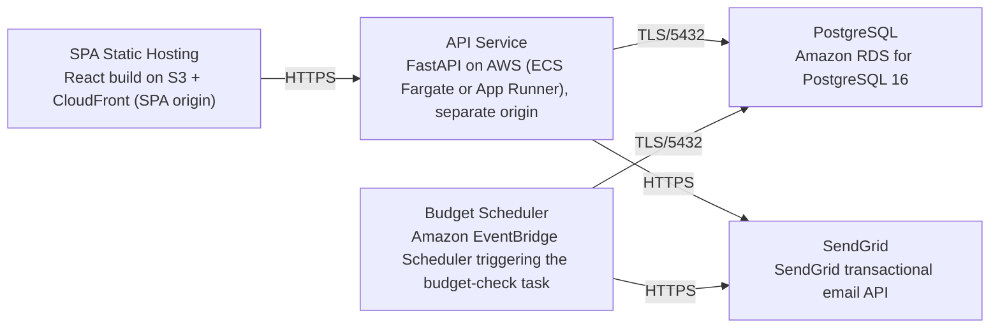

# Architecture

> Maintained by QuorQ AI SDLC. Text between `sdlc:auto` markers is regenerated; anything outside them is yours and is kept.

<!-- sdlc:auto:start narrative -->
## Overview

### ARCH-OVERVIEW · approved · source: architecture:summary

Expense Tracker is architected as a two-origin web app: a React 19 SPA and a FastAPI 0.115 REST API backed by PostgreSQL 16, all on AWS, with a scheduled monthly budget checker and optional SendGrid email alerts.

Users sign up with email/password, log and categorise expenses in a single chosen currency, set per-category monthly budgets, and view dashboard, category-breakdown and spending-trend reports computed directly in PostgreSQL. Budget thresholds raise in-app alerts, with optional transactional email via SendGrid. Authentication uses server-side opaque-token sessions sent as a Bearer header, chosen specifically because the SPA and API live on separate origins. A scheduled AWS job runs monthly budget-limit checks. All personal financial data is private per user, encrypted in transit and at rest, and fully erasable on account deletion to meet GDPR-style expectations. Approved as version 1.

### ARCH-COMP-WEB-SPA · approved · source: architecture:components.web_spa

React 19 single-page app providing the responsive browser UI for the whole product.

Covers sign-up/login, expense logging and editing, categories, budgets, dashboard, charts, and the CSV export trigger. Stores the opaque session token client-side and sends it as `Authorization: Bearer <token>` on every API call. Reads the API base URL from the `VITE_API_BASE_URL` environment variable so it can target a separate-origin backend.

**Related:** ARCH-COMP-API-BACKEND

### ARCH-COMP-API-BACKEND · approved · source: architecture:components.api_backend

FastAPI 0.115 REST API that is the sole backend for the app.

Handles authentication and session management, per-user CRUD for expenses/categories/budgets, currency settings, budget tracking and threshold evaluation, report aggregation queries, CSV export generation, account deletion, and dispatch of budget-alert email. Enforces per-user data isolation on every request (all queries scoped to the authenticated user id).

**Related:** ARCH-COMP-DATABASE, ARCH-COMP-WEB-SPA

### ARCH-COMP-DATABASE · approved · source: architecture:components.database

PostgreSQL 16 is the single durable store for the whole system.

Stores users, sessions, categories, expenses, budgets and alert records. Performs date- and category-based aggregation for trend and breakdown reports directly in the database, and enforces referential integrity and exact monetary totals (via exact numeric money columns, per the technology decision).

**Related:** ARCH-COMP-API-BACKEND, ARCH-DATA-MODEL

### ARCH-COMP-BUDGET-SCHEDULER · approved · source: architecture:components.budget_scheduler

Scheduled FastAPI task that evaluates every user's budgets on a cadence.

Runs periodically (monthly and on a cadence) to evaluate each user's category spending against their monthly limits, record near/over alerts, and trigger optional email notifications for users who have opted in. Shares the backend's Python 3.12 image/codebase rather than being a separate service.

**Related:** ARCH-COMP-API-BACKEND, ARCH-COMP-EMAIL-SERVICE

### ARCH-COMP-EMAIL-SERVICE · approved · source: architecture:components.email_service

SendGrid is the external transactional email provider for budget alerts and account-related messages.

Sends email via the SendGrid API using the `SENDGRID_API_KEY` credential. External SaaS dependency -- no mail server is run by the project.

**Related:** ARCH-COMP-BUDGET-SCHEDULER, ARCH-COMP-API-BACKEND

### ARCH-CP-SIGNUP · approved · source: architecture:critical_paths.signup_and_session_creation

Critical path for account creation and initial session issuance.

A new visitor submits email and password. The backend validates input, checks email uniqueness, hashes the password, creates the user with default categories and a default currency, creates a session, and returns an opaque token in the response body.

**Related:** ARCH-COMP-API-BACKEND, ARCH-COMP-DATABASE, ARCH-COMP-WEB-SPA

### ARCH-CP-AUTH-ISOLATION · approved · source: architecture:critical_paths.authenticated_request_with_per_user_isolation

Critical path enforcing that every protected call is authenticated and scoped to its owner.

Every protected call carries `Authorization: Bearer <token>`. The backend resolves the session, rejects expired or missing tokens, and scopes all queries to the authenticated user id.

**Related:** ARCH-COMP-API-BACKEND, ARCH-COMP-DATABASE

### ARCH-CP-LOG-EXPENSE-BUDGET · approved · source: architecture:critical_paths.log_expense_and_evaluate_budget_threshold

Critical path for logging an expense and immediately re-evaluating its budget impact.

User saves an expense; backend validates a positive amount and required fields, stores it scoped to the user in their currency, recomputes the month-to-date spend for the category, and raises an in-app near/over alert when a threshold is crossed.

**Related:** ARCH-COMP-API-BACKEND, ARCH-COMP-DATABASE

### ARCH-CP-SCHEDULED-BUDGET-EMAIL · approved · source: architecture:critical_paths.scheduled_budget_check_with_optional_email

Critical path for the periodic, system-initiated budget check and optional emailing.

A scheduled job iterates users with budgets, computes current-month spend per category, records any new near/over alerts, and emails opted-in users via SendGrid.

**Related:** ARCH-COMP-BUDGET-SCHEDULER, ARCH-COMP-DATABASE, ARCH-COMP-EMAIL-SERVICE

### ARCH-CP-CSV-EXPORT · approved · source: architecture:critical_paths.csv_export_of_expenses

Critical path for exporting a user's expenses as CSV.

User requests an export; backend streams a CSV of their expenses (amount, category, date, note), returning headers only when there are no rows.

**Related:** ARCH-COMP-API-BACKEND, ARCH-COMP-DATABASE

### ARCH-DATA-MODEL · approved · source: architecture:entities

Six-table PostgreSQL schema covering users, sessions, categories, expenses, budgets and alerts.

users: id, email, password_hash, currency, email_alerts_opt_in, created_at. sessions: id, user_id, token_hash, created_at, expires_at. categories: id, user_id, name, is_default, created_at. expenses: id, user_id, category_id, amount, currency, spent_on, note, created_at. budgets: id, user_id, category_id, monthly_limit, created_at, updated_at. budget_alerts: id, user_id, category_id, period_month, kind, emailed, created_at.

**Related:** ARCH-COMP-DATABASE

### ARCH-API-SURFACE · approved · source: architecture:endpoints

REST API surface exposed by the FastAPI backend, grouped by resource.

Auth: POST /auth/signup (create account, seed default categories/currency, return session token); POST /auth/login (authenticate, generic failure message on bad credentials); POST /auth/logout (revoke current session token). Account: GET /me (profile + currency); PATCH /me (update currency, email-alert opt-in); DELETE /me (permanently delete account and all owned data, revoke sessions -- GDPR erasure). Categories: GET /categories (list defaults + custom); POST /categories (add custom, non-empty/non-duplicate name); PATCH /categories/{id} (rename, reflected everywhere). Expenses: GET /expenses (list, most recent first); POST /expenses (log, positive amount/category/date, optional note, returns updated budget status); PATCH /expenses/{id} (edit, reflected in list/budgets/reports); DELETE /expenses/{id} (delete after confirmation, removed from budgets/reports); GET /expenses/export (CSV export, amount/category/date/note, headers-only when empty). Budgets: GET /budgets (per-category monthly budgets with spent/limit/remaining); PUT /budgets/{category_id} (set/update positive monthly limit). Alerts: GET /alerts (current in-app near/over alerts). Reports: GET /reports/dashboard (current-month summary + budget status); GET /reports/breakdown (total spent per category for a period); GET /reports/trends (total spending per time period over time).

**Related:** ARCH-COMP-API-BACKEND, ARCH-DATA-MODEL

### ARCH-DEPLOY-TOPOLOGY · approved · source: architecture:deployment_nodes

Five deployment nodes on AWS (plus external SendGrid) implementing the components.

SPA Static Hosting: React build served as static assets from S3 + CloudFront (SPA origin). API Service: FastAPI on AWS, ECS Fargate or App Runner, running Python 3.12 / Uvicorn, on a separate origin from the SPA. PostgreSQL: Amazon RDS for PostgreSQL 16. Budget Scheduler: Amazon EventBridge Scheduler triggering the budget-check task, using the same Python 3.12 backend image. SendGrid: external SaaS transactional email API, no node to manage.

**Related:** ARCH-COMP-WEB-SPA, ARCH-COMP-API-BACKEND, ARCH-COMP-DATABASE, ARCH-COMP-BUDGET-SCHEDULER, ARCH-COMP-EMAIL-SERVICE

### ARCH-TECH-FRONTEND · approved · source: architecture:technology_decisions.frontend

React 19 chosen as the frontend framework over Vue and Svelte.

Builds the responsive, form-and-chart expense/budget/report screens as a SPA served from its own origin, reading the API base URL from VITE_API_BASE_URL and sending the session token as a Bearer header. Alternatives considered: Vue, Svelte.

**Related:** ARCH-COMP-WEB-SPA

### ARCH-TECH-BACKEND · approved · source: architecture:technology_decisions.backend

FastAPI 0.115 chosen as the backend framework over Flask and Django REST Framework.

Provides the lean REST API for auth, per-user CRUD, budget evaluation, report aggregation and CSV export, with Pydantic validation enforcing positive amounts and required fields, and Python data tooling making trend/breakdown math straightforward. Alternatives considered: Flask, Django REST Framework.

**Related:** ARCH-COMP-API-BACKEND

### ARCH-TECH-DATABASE · approved · source: architecture:technology_decisions.database

PostgreSQL 16 chosen as the database over MySQL and SQLite.

Stores users, categories, expenses, budgets and alerts with exact numeric money columns, and performs date- and category-based GROUP BY aggregation for dashboard, breakdown and trend reports directly in the database, with cascade deletes supporting GDPR-style erasure. Alternatives considered: MySQL, SQLite.

**Related:** ARCH-COMP-DATABASE

### ARCH-TECH-CLOUD · approved · source: architecture:technology_decisions.cloud

AWS chosen as the cloud provider over Google Cloud and Azure.

Hosts the SPA (S3 + CloudFront), the API (Fargate/App Runner), managed PostgreSQL (RDS) and the scheduled budget check (EventBridge) in one account, with encryption at rest and TLS in transit satisfying the project's privacy requirements. Alternatives considered: Google Cloud, Azure.

**Related:** ARCH-DEPLOY-TOPOLOGY
<!-- sdlc:auto:end narrative -->

<!-- sdlc:auto:start building-blocks -->
## Building Block View

| ID | Name | Technology | Responsibility | Depends on |
|---|---|---|---|---|
| web_spa | React Web SPA | React 19 | Responsive browser UI for sign-up/login, expense logging and editing, categories, budgets, dashboard, charts, and CSV export trigger. Stores the opaque session token and sends it as Authorization: Bearer on every API call. Reads API base URL from VITE_API_BASE_URL. | api_backend |
| api_backend | FastAPI Backend | FastAPI 0.115 | REST API handling authentication and session management, per-user CRUD for expenses, categories and budgets, currency settings, budget tracking and threshold evaluation, report aggregation queries, CSV export generation, account deletion, and email dispatch for budget alerts. Enforces per-user data isolation on every request. | database, email_service |
| database | PostgreSQL Database | PostgreSQL 16 | Durable storage of users, sessions, categories, expenses, budgets and alert records. Performs date- and category-based aggregation for trend and breakdown reports and enforces referential integrity and exact monetary totals. | — |
| budget_scheduler | Scheduled Budget-Alert Checker | FastAPI 0.115 | Runs periodically (monthly and on a cadence) to evaluate each user's category spending against monthly limits, record near/over alerts, and trigger optional email notifications for opted-in users. | database, email_service |
| email_service | SendGrid Transactional Email | SendGrid | Sends transactional emails (budget alerts, account-related messages) via API using SENDGRID_API_KEY. External SaaS, no mail server to run. | — |

<!-- sdlc:auto:end building-blocks -->

<!-- sdlc:auto:start runtime -->
## Runtime View

### Sign-up and session creation

A new visitor submits email and password. The backend validates input, checks email uniqueness, hashes the password, creates the user with default categories and a default currency, creates a session, and returns an opaque token in the response body.

- **Components:** web_spa, api_backend, database
- **Modules:** auth.router, auth.service, users.repository, categories.service
- **Key functions:** signup(email, password), hash_password(password), seed_default_categories(user_id), create_session(user_id)

### Authenticated request with per-user isolation

Every protected call carries Authorization: Bearer <token>. The backend resolves the session, rejects expired or missing tokens, and scopes all queries to the authenticated user id.

- **Components:** web_spa, api_backend, database
- **Modules:** auth.dependencies, auth.service, common.repository
- **Key functions:** get_current_user(authorization), resolve_session(token), reject_if_expired(session)

### Log expense and evaluate budget threshold

User saves an expense; backend validates a positive amount and required fields, stores it scoped to the user in their currency, recomputes the month-to-date spend for the category, and raises an in-app near/over alert when a threshold is crossed.

- **Components:** web_spa, api_backend, database
- **Modules:** expenses.router, expenses.service, budgets.service, alerts.service
- **Key functions:** create_expense(user_id, amount, category_id, date, note), month_to_date_spend(user_id, category_id, month), evaluate_budget(user_id, category_id, month), record_alert(user_id, category_id, month, kind)

### Scheduled budget check with optional email

A scheduled job iterates users with budgets, computes current-month spend per category, records any new near/over alerts, and emails opted-in users via SendGrid.

- **Components:** budget_scheduler, database, email_service
- **Modules:** scheduler.job, budgets.service, alerts.service, email.client
- **Key functions:** run_budget_checks(now), evaluate_budget(user_id, category_id, month), send_alert_email(user_email, alert)

### CSV export of expenses

User requests an export; backend streams a CSV of their expenses (amount, category, date, note), returning headers only when there are no rows.

- **Components:** web_spa, api_backend, database
- **Modules:** export.router, export.service
- **Key functions:** export_expenses_csv(user_id), stream_csv(rows)

<!-- sdlc:auto:end runtime -->

<!-- sdlc:auto:start deployment-view -->
## Deployment View

| Name | Service | Runtime | Scaling | Environment |
|---|---|---|---|---|
| SPA Static Hosting | React build on S3 + CloudFront (SPA origin) | Static assets | CDN-backed, auto | dev |
| API Service | FastAPI on AWS (ECS Fargate or App Runner), separate origin | Python 3.12 / Uvicorn | 1 task, scalable | dev |
| PostgreSQL | Amazon RDS for PostgreSQL 16 | PostgreSQL 16 | Single instance, encrypted storage, automated backups | dev |
| Budget Scheduler | Amazon EventBridge Scheduler triggering the budget-check task | Python 3.12 (same backend image) | On schedule | dev |
| SendGrid | SendGrid transactional email API | External SaaS | Managed by provider | dev |

| Source | Target | Protocol |
|---|---|---|
| SPA Static Hosting | API Service | HTTPS |
| API Service | PostgreSQL | TLS/5432 |
| Budget Scheduler | PostgreSQL | TLS/5432 |
| API Service | SendGrid | HTTPS |
| Budget Scheduler | SendGrid | HTTPS |

<!-- sdlc:auto:end deployment-view -->

<!-- sdlc:auto:start decisions -->
## Architecture Decisions

| Layer | Choice | ADR |
|---|---|---|
| Frontend | React 19 | [ADR-0001](adr/frontend.md) |
| Backend | FastAPI 0.115 | [ADR-0002](adr/backend.md) |
| Database | PostgreSQL 16 | [ADR-0003](adr/database.md) |
| Cloud | AWS | [ADR-0004](adr/cloud.md) |
<!-- sdlc:auto:end decisions -->

<!-- sdlc:auto:start links -->
## Related Documents

- [Data Model](data-model.md)
- [API Specification](api/openapi.yaml)
- [Architecture Decision Records](adr/README.md)
<!-- sdlc:auto:end links -->
