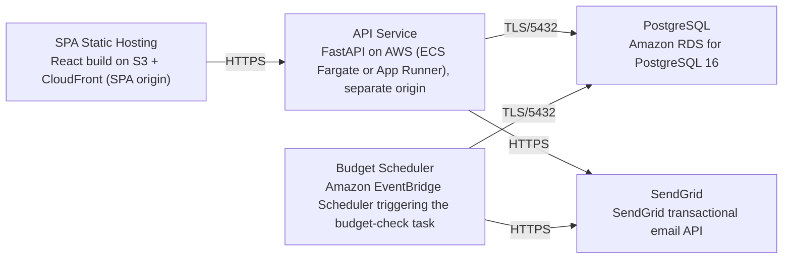

# Deployment Guide

> Maintained by QuorQ AI SDLC. Text between `sdlc:auto` markers is regenerated; anything outside them is yours and is kept.

<!-- sdlc:auto:start how-it-deploys -->
Pushes to `main` run `.github/workflows/deploy.yml`, which builds the API image (if there is a backend) and deploys the SPA to AWS Amplify. Commits touching only `docs/sdlc/**` don't deploy. Deployments can also be started from the platform's Deployment tab.
<!-- sdlc:auto:end how-it-deploys -->

<!-- sdlc:auto:start environments -->
| Name | Service | Runtime | Scaling | Environment |
|---|---|---|---|---|
| SPA Static Hosting | React build on S3 + CloudFront (SPA origin) | Static assets | CDN-backed, auto | dev |
| API Service | FastAPI on AWS (ECS Fargate or App Runner), separate origin | Python 3.12 / Uvicorn | 1 task, scalable | dev |
| PostgreSQL | Amazon RDS for PostgreSQL 16 | PostgreSQL 16 | Single instance, encrypted storage, automated backups | dev |
| Budget Scheduler | Amazon EventBridge Scheduler triggering the budget-check task | Python 3.12 (same backend image) | On schedule | dev |
| SendGrid | SendGrid transactional email API | External SaaS | Managed by provider | dev |
<!-- sdlc:auto:end environments -->

<!-- sdlc:auto:start live -->
**Frontend URL:** https://p0e5338af540f.dshared.amplifyapp.local

**Backend URL:** https://0e5338af540f.local.awsapprunner.local

**Database:** PostgreSQL · aisdlc_0e5338af540f

**Version:** 32e32a97ec2e

**Commit:** `32e32a9`

**Finished:** 2026-11-13
<!-- sdlc:auto:end live -->

<!-- sdlc:auto:start topology -->

<!-- sdlc:auto:end topology -->
